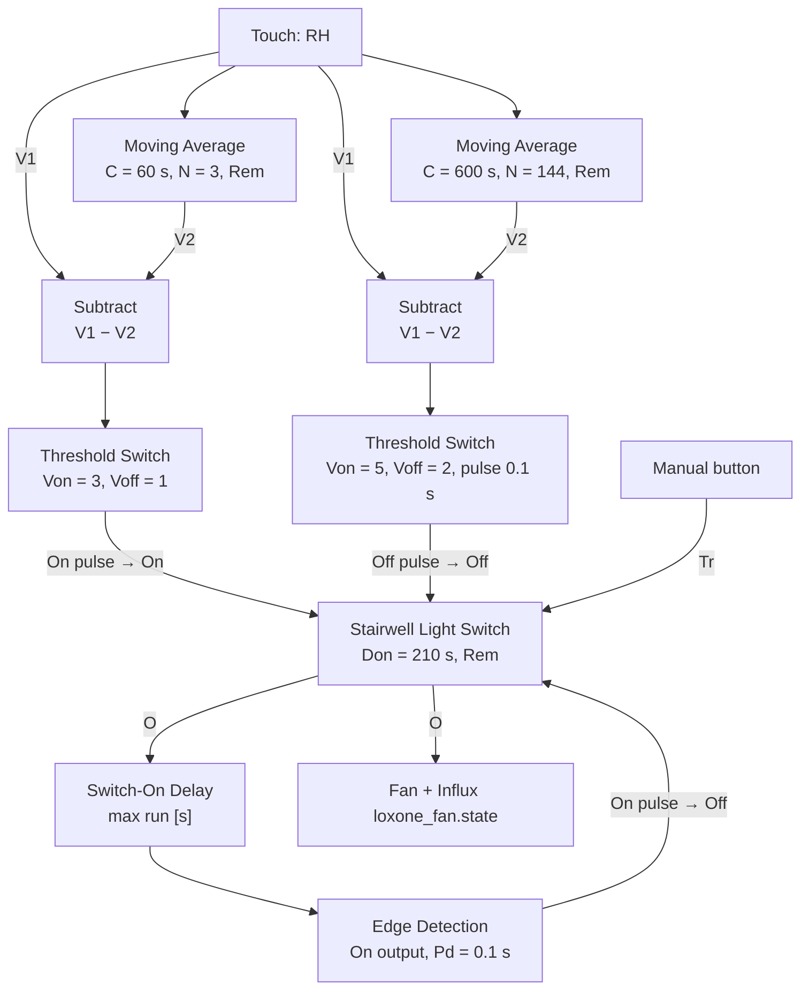

# Loxone: bathroom fan, block behaviour and integration

Collected 2026-11-04 from earlier agent sessions. Living reference: update it as things are tested. Every claim is marked: [measured] Influx data, [user] the user tested it, [docs] Loxone docs, [forum] forum reports, [guess] unverified.

## Bathroom fan: current wiring (2026-11-04)

Native blocks, no Program block. Not yet proven over several showers.

Max run value not recorded. Two wires straight into Stairwell Off, without OR: untested [guess].

- RH (Touch) → Moving Average C=60 s, N=3, Rem → Subtract V2; RH → Subtract V1 → Threshold Switch Von=3, Voff=1. Its **On** pulse → Stairwell **On**.
- RH → Moving Average C=600 s, N=144, Rem → Subtract V2; RH → Subtract V1 → Threshold Switch Von=5, Voff=2, pulse 0.1 s. Its **Off** pulse → Stairwell **Off**.
- Stairwell **O** → Switch-On Delay (max run, seconds) → Edge Detection **On** output, Pd=0.1 s → Stairwell **Off**.
- Manual button → Stairwell **Tr**. Don=210 s is the user's manual run. Stairwell **O** → fan and Influx `loxone_fan.state`.
- Exactly **one** Stairwell block: it carries the visualisation that shows whether the fan runs. Two blocks were rejected.
- OR before Off: the user wants to drop it and wire both pulses straight to Off. Whether Off accepts two sources is not in the docs [guess]; test each source alone.

## Bathroom fan: findings

- [user] Stairwell On must get a **pulse**. Tested 2026-11-04. A steady On is why the app could not turn the fan off (the app symptom itself is [user]; the mechanism is [guess]).
- [measured] A steady On held the output for 634 s with Don=210 s (2026-11-04 15:52:34 to 16:03:08 UTC). What ended that run is unexplained; the max-run value was never confirmed.
- [measured] Mid-shower dip: 2026-11-04 RH 65 at 06:24:17, 61.9 at 06:27:11, 63.9 at 06:27:56, then up to 69.9. Base 60.1. With Von=2.5 the 1.8 difference fired Off, which is why Von went to 5 (first peak was 4.9, then 6.0).
- [user] That morning was atypical: fan off early and nobody ran it manually, so its 9.9 peak and ~68 min above the stop level are probably inflated.
- [measured] 14 days to 2026-11-04, RH minus own 24 h mean: likely showers peak 5.6-9.9, closest 5.6; other events 3.4-4.6; time above +2 about 26-60 min on other mornings. Peaks may be lower with the fan running from the start. Under Von no Off fires and the fan runs to max run. If that happens often, try Von=4, which accepts some early-stop risk.
- [measured] Earlier: shower rises ≥3.5 %RH in 3 min, noise ≤2. Winter median RH 57-62, not dry. Temperature adds little, so RH alone is used.
- [measured] Fan started on config save at 2026-11-04 15:52:34 with RH flat at 59.7. Cause: Avg 3 min without Rem restarting empty [guess]. Rem added; judge on the second save after adding it.
- [user] Washer/dryer opening also triggers it; accepted, automate separately.
- A 120 s Switch-off delay on the stop was an agent's guess from one dip and the user rejected it. An RS Flipflop holding On was removed because of the app problem.
- The old PicoC Program block worked per the user but was "brutally complex", and its baseline reset on every restart.

## Block behaviour

- [docs] Stairwell Light Switch: inputs Tr, Off, On, DisPc; parameters Don, Tw, Dw, Rem; outputs O, API.
- [docs] Off inputs (Stairwell, Push Button, Pulse Generator, delays): under 200 ms resets, **over 200 ms locks the block**, over 500 ms sets the sensor name on some blocks. Keep pulses at 0.1 s.
- [docs] Edge Detection: input I; outputs P, On (rising), Off (falling); Pd default **1 s**, which would lock an Off input.
- [docs] Threshold Switch: one input, typed Von/Voff with hysteresis; outputs O plus On and Off pulses with configurable duration. Von<Voff inverts it.
- [docs] Comparator: V1, V2, Von, Voff, output De. Docs do not say whether negative differences count, so Threshold Switch was used instead.
- [docs] Moving Average: V, R; output Avg; C (s), N, Rem. Maximum N is not documented; N=144 was accepted on the user's Miniserver as far as known [guess].
- [docs] Rem saves on planned reboot, backup, config save, and hourly. So a power cut can lose up to about an hour.
- [forum] Logic may start before remanent values are restored.
- [docs] RS Flipflop: S, Tg, R (R dominant), output O, Rem. SR Flipflop: Set dominant.
- [docs] Subtract O=V1-V2. Greater or Equal: V1, V2. Pulse Generator: Don, Doff, Off, Inv. Delay blocks: Switch-On Delay; Switch-On and -Off Delay. "Stairwell Light Switch" is the English name of schodišťový spínač.
- [docs] Push notification: object under Messages; text set in the output connector; sends when input is 1; recipients come from object permissions; limit 200/day. One object per recipient group.
- [docs/guess] Text Generator: generates on rising Tr; falling Tr resets text. Several triggers via OR need short pulses or no new edge arrives. Merge design: Monoflop 2 s, `Td` 100 and 200 ms. Untested.
- [forum] `Txt1`-`Txt4` empty while `Txt` worked, fixed by updating Config.
- [guess] A memory flag with several writers: untested; check whether its copy has an input connector.
- A status edge fires again after config save if the status is non-zero. The user accepted one repeat message rather than a lock circuit.

## Integration and data

- Topics, EMQX rules, Telegraf and buckets: `homelab:docs/iot-overview.md`. Loxone publishes `iot/loxone/state`; Virtual inputs only take simple text/plain payloads, so EMQX republishes notifications.
- Influx: bucket `loxone` 14 days raw, `loxone_downsample` 10 min means forever. Fields: `loxone_touch` humidity, temperature, humidity_avg_24; `loxone_fan` state, auto. Tag room=bathroom. Query through Grafana `/api/ds/query`, datasource `influxdb2-server1`. Values log on change only, so fill forward.
- Dashboard: `ConfigMap.grafana.dashboard.loxone.valves_temperature_humidity.yaml` in homelab. Its "Fan stop level" still draws avg+3, and the stop is now avg+2. Change only with the user's go-ahead.
- Vacuum c102gl: siid 4 / piid 41 `no-water-info`: 0 none, 2 seen after a run, cleared when cleaning starts; value 1 likely means dismissed, from the Dreame integration, not confirmed for c102gl.
- How to answer on Loxone: [the no-guessing note](../../raw/2026-11-04-loxone-wiring-answers-no-guessing-no-unrequested-blocks.md).
